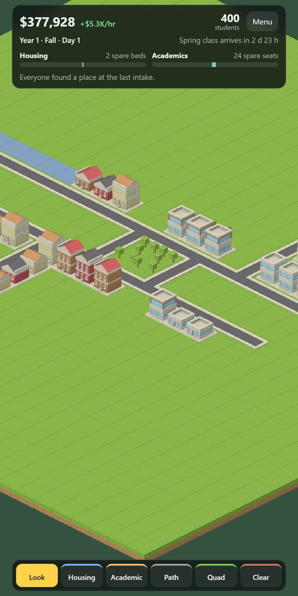

# Campus Tycoon

A mobile idle game where you run a fictional university. You zone land for housing and classrooms, the campus builds itself, and a new class arrives every game year. The game runs on real time, so the campus keeps growing while the app is closed.

This is the first playable: zoning, growth, a yearly intake, a waitlist, and a list of what happened while you were away. Football, budgets, services and the rest are designed in [DESIGN.md](DESIGN.md) and not built yet.



## Run it

You need Node 22 or newer.

```bash
npm install
npm run dev
```

Then open http://localhost:5183. Dev builds have time-skip buttons under Menu, and opening http://localhost:5183/?demo shows a small tended campus without touching your save.

## Test it

```bash
npm test
```

runs the unit tests for the simulation.

```bash
npm run simulate
```

plays several game years without a screen, with an absent player, a casual player and an optimizer, then checks the results. Options: `npm run simulate -- --years 10 --seeds 1,2,3`.

```bash
npm run build
```

type-checks and writes the web build to `dist`.

## How it ships

- **Web:** Cloudflare Pages builds and deploys every push to `main`. The build includes a service worker, so the game opens with no connection and offers each new version with an Update button.
- **iOS:** the same game wrapped with Capacitor. Pushing a tag that starts with `v` builds it on Codemagic and uploads it to TestFlight.

Signing files, keys and tokens live in Cloudflare and Codemagic settings. None is in this repository.

## How it is put together

- `src/sim` is the simulation in plain TypeScript. It never reads the clock or draws anything. Time is passed in, and the same inputs always give the same campus.
- `src/app` holds the clock, the store and the saves.
- `src/game` draws the map with Phaser 3.
- `src/ui` is the heads-up display in plain HTML.
- `art/recipes` and `tools/build_art.py` assemble the sprites into one atlas.

## Art

The art in this repository is Kenney's public-domain isometric tiles. A build can swap in a paid art pack from a private store when it is given access. Without that access the game builds and runs with the Kenney art. See [CREDITS.md](CREDITS.md) for every third-party pack and its licence.

## Rights

Copyright (c) 2026 GoalLearner. All rights reserved.

The source is public so that people can read it. It is not open source, and no licence is granted to copy, modify, redistribute or publish it, in whole or in part. Third-party art keeps its own licence, listed in [CREDITS.md](CREDITS.md).
